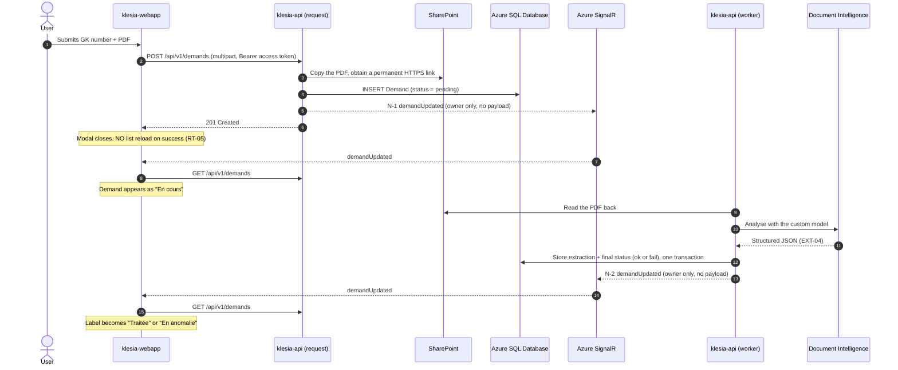
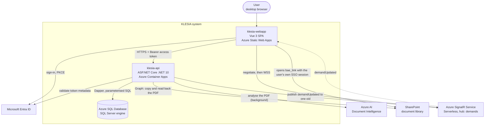
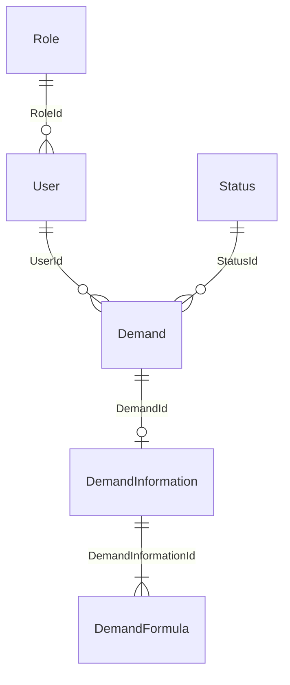

# KLESIA — Software Architecture Plan

**Document ID:** KLESIA-ARCH
**Version:** 1.1
**Date:** 2026-11-19
**Status:** Baseline — agreed structure, open items tracked in §14
**Language:** English (all user-facing product text is French, §3 AP-13)
**Audience:** Architects, backend and frontend engineers, database and infrastructure engineers, QA, and AI coding agents working in this workspace

---

## 1. Introduction

### 1.1 Purpose

This document is the **technical blueprint of the KLESIA system as a whole**. It describes how the system is structured, how its two applications interact, which rules govern that interaction, and *why* the architecture is the way it is.

It exists so that a developer or a coding agent working inside one application can understand the system it belongs to without reverse-engineering the other side.

### 1.2 Scope

| In scope | Out of scope |
|---|---|
| The whole KLESIA system: `klesia-api`, `klesia-webapp`, the shared HTTP contract, and the external services both depend on | Implementation rules internal to one application (they belong to that application's `CLAUDE.md` and specification) |
| Architectural boundaries, responsibilities, integration rules, data ownership, security and deployment topology | Delivery planning, sprint content, estimates, task breakdown (`klesia_webapp/docs/TASKS.md`) |
| The rationale and trade-offs behind the structural decisions | Restating the functional requirements, acceptance criteria or HTTP schemas already specified elsewhere |

**This document describes *how the system is designed and why*. It is not a development plan and does not say *what to build when*.**

### 1.3 Relationship to the other documents

This plan deliberately **references rather than duplicates**. Requirement identifiers (`DEC-14`, `AUTH-01`, `HOST-04`, `RT-04`, `AC-52`, `OPEN-08`…) point into the owning document, which stays the authority on its own detail.

```text
architecture-plan.md          <- this document: system structure, boundaries, rationale (WHY/HOW)
contracts/openapi.yaml        <- the HTTP boundary, machine-readable and machine-checkable
klesia_api/docs/specs/SPECIFICATIONS.md       <- backend behaviour, database, hosting, extraction
klesia_webapp/docs/specs/SPECIFICATIONS.md    <- frontend behaviour, UI, tests, deployment
CLAUDE.md (root and per application)          <- how agents must work in this workspace
.claude/skills, .claude/agents                <- executable governance (check-contract, integration-test, integration-reviewer)
```

### 1.4 Source-of-truth precedence

When sources disagree, resolve in this order:

1. **Explicit, current instructions from the project owner.**
2. **`contracts/openapi.yaml`** for anything observable on the wire: routes, schemas, status codes, headers, CORS, auth requirements.
3. **The owning application's `SPECIFICATIONS.md`** for behaviour on its own side of the boundary.
4. **This document** for cross-application structure, responsibility boundaries and rationale.
5. **Mockups**, then existing repository conventions.

**Governance rule (GOV-01).** A disagreement between a specification and the contract is a **defect, not a choice**. It is resolved by changing *both* documents in the same change, starting with the owning specification (API spec `DEC-08`), and never by making code match whichever document is convenient. One such disagreement is open today; see §14.4.

---

## 2. System Overview

### 2.1 What KLESIA does

KLESIA manages **membership demands** (*demandes d'adhésion*). An authenticated user:

1. signs in with their Microsoft Entra ID account;
2. sees the list of **their own** demands, each with a GK (Geode Klesia) number, a link to its BAE PDF (*Bulletin d'Adhésion Entreprise*) and a processing status;
3. creates a new demand by submitting a GK number and one PDF;
4. watches that demand progress to its final state **without any manual action**, because the backend pushes a real-time signal at each stage.

### 2.2 The reference scenario

This single scenario exercises every architectural mechanism in the system and is the best summary of how the parts fit together (API spec §7, webapp spec §1.1, `AC-52`).



Three architectural properties are visible here and are load-bearing for the whole system:

- **The notification is a signal, never data.** `demandUpdated` carries no arguments; the frontend re-reads authoritative state from the API (`AP-09`).
- **The write path never informs the read path directly.** A successful `POST` triggers *no* list reload; only notifications do (`RT-05`).
- **Long work leaves the request.** The extraction runs after the response, in the background, with the database as the only record of progress.

### 2.3 Responsibility split

| Concern | Owner | Never done by |
|---|---|---|
| Business rules, workflow, status transitions | `klesia-api` | the frontend |
| Authentication of the user | Microsoft Entra ID, via MSAL in the browser | custom code on either side |
| Authorisation (who may see what) | `klesia-api`, server-side, from the token | the frontend (it is presentation only) |
| Document storage and access control | SharePoint | the database, the API disk, the browser |
| Content extraction (OCR) | Azure Document Intelligence | the API's own code, the frontend |
| Real-time delivery | Azure SignalR Service (Serverless) | custom WebSocket code, polling |
| Schema ownership | the SQL database project (`database/Klesia.Database`) | the API at runtime, an ORM |
| Presentation, interaction, French wording | `klesia-webapp` | the API (it returns codes, not labels) |

---

## 3. Architecture Principles

These are the rules that must survive every future change. They are the standard against which a design review or `integration-reviewer` judges a proposal.

| ID | Principle | Consequence |
|---|---|---|
| **AP-01** | **Contract first.** No HTTP behaviour changes before `contracts/openapi.yaml` changes. | A behaviour diff without a contract diff is a defect (root `CLAUDE.md`, GOV-01). |
| **AP-02** | **Business logic lives in the backend.** | The frontend validates for usability, never for correctness; the backend re-validates everything (`GK` format, PDF content, size, ownership). |
| **AP-03** | **Dependencies point inward.** `WebApi → Infrastructure → Application → Domain`. | Domain knows nothing of HTTP, SQL Server, Azure or SignalR. |
| **AP-04** | **One client layer.** The SPA reaches the API only through its service layer; visual components never call `fetch`. | Transport, auth and error mapping exist once (`demandService.ts`, `realtimeService.ts`). |
| **AP-05** | **Identity comes from the token.** The user is the `oid` of a validated access token. | No `user_id` is ever accepted in a path, query, header or body (`DEC-20`). |
| **AP-06** | **Fail closed, disclose nothing.** | Unknown user and disabled user return an identical `403`; bodies carry no stack trace, SQL, token, link or other user's data. |
| **AP-07** | **Configuration over code, and no secrets.** | Tenant, origins, endpoints, limits are configuration validated at startup; the API holds no secret at all (`HOST-07`). |
| **AP-08** | **Stateless replicas; the database is the only authority.** | Any replica serves any request; nothing correctness-bearing lives in memory or on the container disk (`HOST-08`). |
| **AP-09** | **Push signals, it does not carry.** | Notifications have no payload and are never trusted or rendered; the client re-reads state (`RT-03`, `NOT-04`). |
| **AP-10** | **Passwordless, managed identity everywhere.** | Azure SQL Database, SharePoint/Graph, Document Intelligence and SignalR are all reached with one user-assigned managed identity (`DEC-06`, `HOST-06`). |
| **AP-11** | **One owner per responsibility.** | No parallel implementation of auth, HTTP access, the domain model or the reload trigger on either side. |
| **AP-12** | **The SQL database project owns the schema.** | No EF Core, no `DbContext`, no runtime DDL; the schema is declared in `database/Klesia.Database` and published as a DACPAC with data-loss blocking on (`DEC-02`, `DB-11`, API specification §3.5). |
| **AP-13** | **French for users, English for engineers.** | All UI text is French and chosen client-side from status codes; all code, identifiers, tests and documents are English. |
| **AP-14** | **No speculative capability.** | No extra route, field, event, library or refresh trigger beyond what is specified (`DEC-22`, `RT-04`). |

---

## 4. System Architecture

### 4.1 Context



### 4.2 The complete system surface

The entire externally observable surface of KLESIA is **four HTTP operations and one real-time event**. Anything else is an architectural change.

| Surface | Purpose | Auth |
|---|---|---|
| `GET /health` | Container Apps startup and readiness probe | anonymous |
| `GET /api/v1/demands` | The signed-in user's identity and own demands, newest first, unpaginated | Entra access token |
| `POST /api/v1/demands` | Create one demand from a GK number and a PDF | Entra access token |
| `POST /api/v1/notifications/negotiate` | SignalR negotiation for the `demands` hub | Entra access token |
| `demandUpdated` (SignalR, not HTTP) | "Your demands changed" — no arguments, owner only | SignalR connection token |

### 4.3 Trust boundaries

```text
  [ browser: untrusted ]  --(1)--  [ Container Apps ingress: TLS terminates ]  --(2)--  [ API process ]
                                                                                           |
                                                            (3) managed identity, no secret |
                                                                                           v
                                                        [ Azure SQL ] [ SharePoint ] [ Doc Intelligence ] [ SignalR ]
```

1. Everything from the browser is untrusted input, including the notification payload, the GK number, the file and its declared MIME type.
2. TLS ends at the ingress; the API speaks plain HTTP on port 8080 and derives the client protocol and address from `X-Forwarded-*` only because the ingress is the sole network entry point (`HOST-03`, `HOST-04`).
3. Outbound access is identity-based, never key-based or password-based.

### 4.4 What deliberately does not exist

Recording the absent components is as architecturally meaningful as recording the present ones.

- **No BFF, API gateway or server-side rendering.** The SPA is static files; the API is reached directly by the browser.
- **No message broker.** Background work is an in-process bounded queue behind the `IExtractionQueue` port, with a database recovery sweep as the durability mechanism (`EXT-01`, `EXT-09`). Replacing it with Azure Service Bus is the planned escape hatch (`OPEN-10`, §15.3).
- **No server-side session, cookie or data-protection key ring.** Bearer tokens only, hence no sticky sessions.
- **No ORM.** Dapper with hand-written parameterised SQL (`DEC-02`).
- **No polling, no refresh button, no refetch on focus.** The list reloads only on the four triggers of `RT-04`.
- **No client-side state framework.** No Pinia, no Vue Router — the application is a single screen plus a modal.
- **No read route for extracted data.** It is stored and stays internal (`DEC-22`).

---

## 5. Technology Stack

| Layer | Technology | Notes / decision |
|---|---|---|
| Frontend framework | Vue 3, Composition API, `<script setup lang="ts">` | strict TypeScript |
| Frontend build | Vite, Node.js 26 LTS (build tool only) | `dist/` is the deliverable |
| Frontend auth | `@azure/msal-browser` v5, Authorization Code + PKCE | mandatory `/redirect.html` bridge (`AC-33`, `AC-34`) |
| Frontend real-time | `@microsoft/signalr` official client | no raw WebSocket code |
| Frontend tests | Vitest + Vue Test Utils; ESLint (flat) + Prettier | mocked MSAL and HTTP boundaries |
| Frontend hosting | Azure Static Web Apps | static bundle, platform `/.auth` **not** used |
| Backend runtime | ASP.NET Core on **.NET 10** (`net10.0`) | `DEC-01`, SDK pinned in `global.json` |
| Backend structure | Clean Architecture: `Domain`, `Application`, `Infrastructure`, `WebApi` | `AP-03` |
| Backend data access | **Dapper** + `Microsoft.Data.SqlClient` | `DEC-02`, `DEC-14`; EF Core forbidden |
| Backend auth | `Microsoft.AspNetCore.Authentication.JwtBearer`, v2.0 access tokens | `AUTH-01` |
| Backend tests | xUnit, FluentAssertions, NSubstitute, `WebApplicationFactory` | signed test tokens, in-memory repositories |
| Backend hosting | **Azure Container Apps**, container on HTTP 8080, non-root | `DEC-15` |
| Database | **Azure SQL Database** (SQL Server engine) | `DEC-14` |
| Schema tooling | **SQL database project** (`Microsoft.Build.Sql`, `Klesia.Database.sqlproj`) built into a **DACPAC** and published with `SqlPackage`; idempotent post-deployment seeds | `DEC-02`, `DEC-14`, `DB-11`, API spec §3.5 |
| Identity provider | Microsoft Entra ID, single tenant | `OPEN-03` supplies the values |
| Documents | SharePoint document library via Microsoft Graph, `Sites.Selected` | `DEC-13`, `OPEN-11` |
| Extraction | Azure AI Document Intelligence, custom BAE model | `DEC-18`, `OPEN-09` |
| Real-time service | Azure SignalR Service, **Serverless** mode, hub `demands` | `DEC-16` |
| CI/CD | GitHub Actions, OIDC federated credential, SHA-tagged images | `HOST-12`, `OPEN-08i` |

**Version discipline.** Framework and package versions are pinned where the repository already pins them (`global.json`, `Directory.Packages.props`, `package.json` + `.nvmrc`). Versions are never guessed in documentation; they are read from those files at implementation time.

---

## 6. Application Architecture

### 6.1 `klesia-api` — Clean Architecture with ports and adapters

```text
WebApi           transport + composition root only
  Authentication/ (Entra options, validation, DelegatedUser fallback policy)
  Cors/  Logging/  Contracts/ (snake_case request and response records)
  Controllers/ (DemandsController, NotificationsController)   Program.cs
        |
Infrastructure   adapters: Persistence (Dapper), Documents (SharePoint/Graph),
                 Extraction (Document Intelligence, Channel queue, hosted workers),
                 Notifications (Azure SignalR), Options, DependencyInjection
        |
Application      use cases + ports: DemandService, DemandExtractionService,
                 ExtractionSweepService, validators, DTOs
                 Abstractions/: IUserRepository, IDemandRepository,
                 IDemandExtractionRepository, IBaeDocumentStore, IBaeLinkResolver,
                 IDocumentExtractor, IExtractionQueue, INotifier
        |
Domain           entities and value objects only: ApplicationUser, Demand,
                 GKNumber, DemandStatus, DemandInformation, DemandFormula
```

**Architectural rules.**

- Controllers translate HTTP and nothing else: no business rule, no SQL, no Azure SDK type.
- Every external system is reached through a port declared in `Application` and implemented in `Infrastructure`. Callers never see a `HubConnection`, a `GraphServiceClient`, a `SqlConnection` or a Document Intelligence type.
- **Token validation is separated from business authorisation on purpose**: the JWT middleware proves *who* the caller is (`401`), the authorisation policy proves *what* the token permits (`403`), and the allowlist check lives in `DemandService` because it is a business rule about an application user, not a transport concern (`AUTH-IMPL`).
- The background worker is an `Infrastructure` hosted service driving an `Application` use case. It has no caller, no token and no HTTP context; it takes its inputs from the database and SharePoint only (`AUTH-02`).
- JSON naming is declared explicitly on the `WebApi` contract records. Database casing never leaks into JSON and JSON casing never dictates SQL (`DEC-21`).

**Why this structure.** The two volatile areas of KLESIA are its external dependencies (SharePoint, Document Intelligence, SignalR, and plausibly the queue) and its hosting. Isolating each behind a port means `OPEN-09`, `OPEN-10` and `OPEN-11` can be resolved later by replacing one adapter, with no change to use cases, contracts or tests of the inner layers.

### 6.2 `klesia-webapp` — layered SPA

```text
components/   presentation, interaction, accessibility, French wording
composables/  reusable Vue state and orchestration
services/     authService (MSAL singleton), demandService (typed GET/POST),
              realtimeService (sole owner of the SignalR connection)
models/       demand.ts - hand-written mirror of the contract schemas
config/       environment.ts (build-time VITE_*), runtimeConfig.ts (app-config.json)
utils/        GK number and PDF validation, constants, design tokens
```

**Architectural rules.**

- **No authenticated `fetch` in a visual component** (`AP-04`). A component renders state and emits intent.
- **One shared, coalesced `reloadDemands()`** is the only thing that issues a list `GET`, with the four triggers of `RT-04` (initial load, reconnection, notification, "Réessayer") and never two in flight (`AC-22`).
- **`realtimeService.ts` is the only module that knows SignalR exists.** Components never touch a `HubConnection` (`RT-01`).
- **The domain model is hand-written, not generated** (`MODEL-01` to `MODEL-03`). It mirrors the contract schemas field for field and is verified mechanically by `check-contract`. It is the *only* place backend shapes are represented; redefining them elsewhere is a defect. Introducing a generated client would be an architectural change made in this document and the root `CLAUDE.md` first.
- **Two configuration channels, on purpose.** `VITE_*` variables are public and baked at build time (origins, tenant, scope); `public/config/app-config.json` is read at runtime so an operator can change the PDF size limit by republishing one static file, with no rebuild (`§3.2`). A failure in the runtime channel disables upload only — sign-in and the list keep working (`AC-20`).
- **The SPA trusts nothing.** It never treats `user_id` as proof of identity, never renders server `title`/`detail`, never renders a notification payload, never opens a non-HTTPS `bae_link`, and never persists tokens, GK numbers or links outside MSAL's own cache.

### 6.3 Database project — `database/Klesia.Database`

A standalone **SQL database project** (SDK-style, `Microsoft.Build.Sql`, targeting Azure SQL Database) whose `Schemas/` and `Tables/` files declare the **desired state** of the schema. It is built into a DACPAC and published with `SqlPackage` by the pipeline, **separately from the API** (`HOST-12`); `SqlPackage` computes the difference against the target database and applies it. The `Scripts/` seed files are pulled in by a single `PostDeployment.sql` and run after **every** publish, so they must be idempotent: reference data is merged on its stable `Code`, and the user seed is insert-only so that a user deactivated by an administrator is never reactivated (`DEC-05`). An intentionally empty `database/Directory.Build.props` isolates the project from the .NET build settings.

**Why a separate project.** The runtime identity holds data privileges only — no DDL (`§6.2` of the API specification). Schema change is a deployment-time act performed by a more privileged principal, which is what keeps a compromised API from altering the schema.

**What the declarative model changes.** The definition files always show the *current* schema, and there are no numbered scripts to keep immutable. The price is that the *transition* is computed at publish time, so a rename or a narrowed column can be read as a drop and re-create. Two safeguards are therefore part of the architecture: the publish profile keeps **data-loss blocking enabled** and never drops objects missing from the source, and the generated publish script is **reviewed before it is applied** (`DB-11`).

### 6.4 Development environment

The workspace is itself engineered, and its structure is part of the architecture:

| Asset | Scope | Role |
|---|---|---|
| Root `CLAUDE.md` | workspace | boundary rules and contract governance |
| `klesia_api/CLAUDE.md`, `klesia_webapp/CLAUDE.md` | application | implementation rules for that application only |
| `.claude/skills/check-contract` | workspace | report-only audit: contract validity, specs, database, both applications |
| `.claude/skills/integration-test` | workspace | the cross-application test plan at three levels |
| `.claude/agents/integration-reviewer` | workspace | read-only pre-merge review of the boundary |
| `klesia_api/.claude/*`, `klesia_webapp/.claude/*` | application | per-application agents, skills and hooks |
| `klesia_webapp/tools/dev-simulator/` | frontend | dev-only backend and hub simulator (`SIM-01`…`SIM-06`) |

The two applications are **nested independent Git repositories** (`klesia_api/.git`, `klesia_webapp/.git`), ignored by the root repository. The root repository versions the contract, the shared governance and this document. A cross-application change therefore produces commits in two or three repositories and must be reviewed as one change (`integration-reviewer`).

---

## 7. Integration Architecture

### 7.1 The contract as referee

`contracts/openapi.yaml` is the machine-readable form of the HTTP boundary. Both sides are measured against it, never against each other:

- the API **implements** it and proves conformance with pipeline tests validating real responses against the schemas;
- the SPA **consumes** it and proves conformance by building fixtures from the contract examples and mirroring its schemas in `src/models/demand.ts`;
- `check-contract` verifies the contract itself, then the two specifications, the database and both applications against it;
- the optional live level puts a contract proxy between the two running applications so every real request and response is validated on the wire.

This is what prevents the classic failure mode of two teams agreeing in a meeting and diverging in code.

### 7.2 Request integration

**Authorisation chain — the same for every protected operation, in this order (`§4`):**

```text
valid access token (signature, issuer, tid, audience, lifetime)   else 401
   -> oid claim present and a GUID                                else 401
   -> delegated scope access_as_user in scp                       else 403
   -> user exists in sec.User AND IsActive = 1                    else 403  (identical body)
   -> business logic, scoped to own data only
```

Three properties matter architecturally: the order is fixed; an infrastructure fault is never reported as `403` (it is `5xx`); and both `403` causes are indistinguishable to the caller, so the API never reveals whether an account exists.

**Error model.** Every non-2xx response from an application route is `application/problem+json` (RFC 9457). The **HTTP status is the primary signal**; the SPA selects its own French wording from the status and, for `400`/`422`, from the *keys* of `errors` — never from server text. This is what lets the backend evolve its messages without touching the frontend, and keeps server internals out of the UI.

Responses produced by the ingress rather than the API (`502`, `503`, `504`, a `413` hit at the ingress first) may be non-JSON and carry no correlation header. The SPA therefore treats them generically and offers "Réessayer".

**CORS.** Exactly one CORS policy exists, and it belongs to the API; the Container Apps ingress policy stays **disabled** so two policies can never disagree (`HOST-03`). Exact origins only, never `*`; no credentials; `X-Correlation-Id` exposed; the SignalR client's `X-Requested-With` and `X-SignalR-User-Agent` must be allowed or the negotiate preflight fails.

**Correlation.** Every response carries `X-Correlation-Id`, and `ProblemDetails.traceId` equals it — one identifier joining a user report, a browser trace and a server log.

### 7.3 Real-time integration

```text
SPA --POST /api/v1/notifications/negotiate (Entra access token, Authorization header)--> API
API --returns { url, accessToken }: Azure SignalR endpoint + short-lived connection token--> SPA
SPA --WSS with the connection token--> Azure SignalR Service (hub: demands)
API --REST publish, managed identity, targeted by oid--> Azure SignalR Service --> SPA
```

**Architectural rules.**

- Negotiation is **never skipped**, so the Entra access token stays in an `Authorization` header and never appears in a URL. The only token that may appear in a URL is the short-lived SignalR connection token, a WebSocket limitation.
- The negotiate route is protected exactly like the REST routes, allowlist included: an inactive user cannot open a connection.
- The SignalR `userId` is the validated Entra `oid`. Messages are **targeted to one user; demand activity is never broadcast** (`NOT-02`).
- The event is `demandUpdated`, **case-sensitive, with no arguments**, sent at exactly two moments (`N-1` after the demand is committed, `N-2` after the final status is committed) by exactly two callers. No route triggers a notification (`NOT-05`).
- Publication is **best effort and strictly after the commit** (`NOT-03`). A SignalR outage never changes an HTTP result, a status or an extraction outcome. The client recovers by reloading on every reconnection — which is also why at-most-once delivery with no replay is acceptable.
- The two camelCase names in the negotiate response (`url`, `accessToken`) are fixed by the SignalR protocol and are, with `ProblemDetails`, the only exceptions to the `snake_case` convention.

**Why signal-only notifications.** The alternative — pushing the changed demand — would create a second, weaker copy of the read contract, force the frontend to trust pushed data, and make ordering and replay semantics load-bearing. A contentless signal makes the `GET` the single read path and makes a lost notification a non-event rather than a corruption.

### 7.4 Read-after-write consistency

The demand is committed **before** `201` is returned and **before** `N-1` is published, so the next `GET` is guaranteed to contain it (`INT-12`). This is the contract that allows the frontend to do nothing on `POST` success: there is no optimistic insertion, no timer and no reconciliation logic anywhere in the SPA.

A notification may legitimately arrive **before** the `POST` response. The design absorbs this: each notification coalesces into one reload, and the response adds none (`AC-54`).

### 7.5 Document integration

The browser never uploads to SharePoint and never holds a Graph token. The API copies the PDF into the configured library with a **backend-generated file name**, so repeated submissions of the same GK number cannot overwrite each other, and stores the permanent HTTPS link in `Demand.BaeLink`.

The link is **not signed, not time-limited and not anonymous**: the browser opens it with the user's own Entra SSO session, and **SharePoint permissions are the access gate**. The API attaches no bearer token to it, never builds or alters it, and validates that what it returns is an absolute HTTPS URL. `IBaeLinkResolver` stays a pass-through; making links time-limited would be a separate architectural decision (`OPEN-05`).

### 7.6 Local integration without a backend

The frontend's dev simulator implements the *same* contract over the *same* protocol (real SignalR JSON hub protocol, real negotiate shape), so **no frontend code path differs between development and production** — no `skipNegotiation`, no custom transport, no auth bypass in `src/`. It requires a bearer header but does not validate tokens, which remains a backend responsibility. It is a development aid and never evidence of production conformance (`SIM-06`).

---

## 8. Data Architecture

### 8.1 Data ownership

| Data | System of record | Exposed to the browser |
|---|---|---|
| Users, roles, statuses, demands, extracted information and formulas | Azure SQL Database | only the four fields of a `Demand`, plus `user_id`/`user_name` |
| BAE PDF documents | SharePoint document library | as a permanent HTTPS link, opened under the user's own SSO session |
| User identity, authentication | Microsoft Entra ID | as tokens held by MSAL |
| Extraction results in flight | transient, in the worker | never |
| Real-time events | none — SignalR stores nothing | a contentless signal |

### 8.2 Model

Six tables in one database, grouped by three SQL schemas: `sec` (security), `ref` (reference and lookup data) and `dbo` (business data, extraction tables included) (`DB-02`). Physical names are schema-qualified (`sec.User`); the diagram uses the logical names.



**The identity distinction is the single most error-prone point in the data model** (`§3.2`):

- `sec.User.Id` — internal `INT IDENTITY` primary key, used for foreign keys and never leaves the backend;
- `sec.User.UserUniqueId` — the Entra `oid`, stored as a native `UNIQUEIDENTIFIER`: this is what the API returns as `user_id`, what the allowlist is keyed by, and what SignalR targets;
- `dbo.Demand.Id` — what the contract calls `demand_id` and the SPA uses as its rendering key.

Conflating the first two would either break SignalR targeting or leak an internal identifier into the contract.

### 8.3 Data rules

- **Status vocabulary is closed and terminal.** Exactly `pending`, `ok`, `fail`; a demand leaves `pending` once, and both final states are final. The French labels ("En cours", "Traitée", "En anomalie") exist only in the frontend; an unknown code renders as "Statut inconnu" rather than breaking the list — tolerance on the client, strictness in the contract.
- **GK numbers are not unique.** Duplicate submissions are allowed by design (`INT-09`); each creates a new demand and a new extraction. No uniqueness constraint, no client-side duplicate rule.
- **The list is returned in full**, `demand_id` descending. No pagination, no filtering, no sorting contract. The order is a display default, not a business guarantee — adding pagination later is therefore an additive contract change (§15.3).
- **Extracted data is stored and never exposed** (`DEC-22`). No route reads `DemandInformation` or `DemandFormula`.
- **Third-normal-form associations.** Role, status and user names are never copied onto `Demand`.
- **Referential integrity is declared, deletion is not cascaded.** Deletes use `NO ACTION` and no cascade is declared (`DB-09`).
- **Least privilege at the data layer.** The runtime identity has read access to the six tables (`db_datareader`), `INSERT` on the three `dbo` business tables, and `UPDATE` on the single column `dbo.Demand.StatusId` (a column-level grant). No `DELETE`, no other `UPDATE`, no DDL.
- **Case sensitivity is explicit where it matters.** The model collation is case-insensitive (`1033, CI`), so the checks on `ref.Status.Code` and `dbo.Demand.GKNumber` state a case-sensitive match deliberately, through an explicit binary collation (`Latin1_General_100_BIN2`).

### 8.4 Data flows

| Flow | Path |
|---|---|
| Read | token → `oid` → `sec.User` allowlist → `Demand` where `UserId` = own id → DTO → JSON |
| Write | multipart → validate → SharePoint copy → `INSERT Demand(pending)` → commit → `N-1` → enqueue id |
| Extract | queue id → re-read status/link/owner → SharePoint stream → Document Intelligence → validate → `INSERT` extraction + `UPDATE` status in **one transaction** → `N-2` |
| Recover | sweep finds demands left `pending` beyond `Extraction:StaleAfterMinutes` → re-enqueue |

The extraction write is one transaction and the worker proceeds only if the demand is still `pending` **and** has no `DemandInformation`, so a duplicated hand-over (replica restart plus sweep) is idempotent in effect rather than by lock.

---

## 9. Security Architecture

### 9.1 Position

**The frontend is not a security boundary.** It is a convenience layer: its validation improves usability, its hidden UI is not protection. Every rule that matters is enforced server-side — token validation, per-user authorisation, PDF content and size limits, duplicate policy, and the HTTPS shape of a returned link.

### 9.2 Authentication and authorisation

- Microsoft Entra ID, single tenant, Authorization Code + PKCE in the browser; **v2.0 access tokens issued for this API only**.
- The ID token is **never** used as an API bearer token, and the access token is never sent anywhere but the API origin and the negotiate endpoint (`AC-49`) — never to a `bae_link` origin and never to the SignalR service URL.
- Signature, issuer, `tid`, audience and lifetime are validated by the standard middleware; a token carrying a `nonce` (an ID token) is rejected even if its audience matched.
- The delegated scope `access_as_user` is required by a policy that is also the **fallback policy**, so a newly added endpoint is protected unless explicitly marked anonymous — secure by default.
- The database allowlist is an authorisation gate, not provisioning: a row is never created or updated during a request, and `IsActive = 0` denies access despite a cryptographically valid token.
- **Roles grant nothing today.** `admin`, `operational` and `guest` exist as data; the only rule is *own data only* (`OPEN-04`). Code must not infer role-based behaviour.

### 9.3 Secrets

**The API has no secret.** Database access is passwordless (`Authentication=Active Directory Default`), Graph, Document Intelligence and SignalR use the same user-assigned managed identity, and Entra metadata is public. The SPA has no secret either: every `VITE_*` value is public by construction and baked into the bundle. Consequently there is no key rotation, the database connection string carries no secret, and there is nothing to leak in an image, a repository or a log.

If a secret ever becomes unavoidable it is a Container Apps secret or a Key Vault reference resolved through the managed identity — never in the image, the repository, a Bicep default or a log (`HOST-07`).

### 9.4 Browser-side protections

A strict Content-Security-Policy is served by Static Web Apps (`default-src 'self'`; `script-src 'self'` with no `unsafe-inline`/`unsafe-eval`; `object-src 'none'`; `frame-ancestors 'none'`; `connect-src` enumerating Entra, the API origin and the SignalR origin over `https:`/`wss:`, never `*`), plus `nosniff`, a referrer policy and a restrictive permissions policy. The MSAL redirect bridge is served `no-store` and deliberately carries **no** `Cross-Origin-Opener-Policy`, which would break the redirect flow.

Rendering is inert: no `v-html`, no `innerHTML`, no dynamic evaluation. A `bae_link` that is not `https:` is rendered as plain text rather than a link, which neutralises `javascript:`, `data:` and `blob:` values.

### 9.5 Data protection in operation

Never logged, persisted client-side or placed in a URL: tokens, GK numbers, `bae_link` values, uploaded file names, document contents, extracted business data (company names, SIREN/SIRET, addresses, contact details) and connection strings. Logs never associate an `oid` with a GK number or a link. Error bodies carry none of it either.

### 9.6 Defence in depth on the upload path

A PDF is checked at four independent points: the SPA (type and size, from runtime configuration), the ingress (body limit), the API (`multipart` shape, real `%PDF-` content, `Upload:MaxPdfSizeMb`), and SharePoint (library permissions). The limits must be aligned deliberately — see `INT-05` and `OPEN-08f`.

---

## 10. Deployment Architecture

### 10.1 Topology

```text
Browser ──HTTPS──> Azure Static Web Apps (klesia-webapp: dist/, headers, SPA fallback)
Browser ──HTTPS──> Container Apps ingress (TLS ends here) ──HTTP:8080──> klesia-api replicas
Browser ──WSS────> Azure SignalR Service
Browser ──HTTPS──> SharePoint (user's own SSO session)

klesia-api ──TLS:1433──> Azure SQL Database
klesia-api ──HTTPS─────> Microsoft Graph (SharePoint), Document Intelligence, Azure SignalR
           all outbound calls authenticated by one user-assigned managed identity
```

### 10.2 Runtime characteristics

- **Image.** Multi-stage `Dockerfile` at the API repository root; the final image holds only the published API — no database project or DACPAC, tests, docs, `.claude/`, local settings or `.git`. Base images pinned; deployed images tagged with the **commit SHA**, never `latest`.
- **Process.** Plain HTTP on 8080, non-root user, no certificate and no Kestrel TLS.
- **Probes.** Startup and readiness use `GET /health`; **liveness is a TCP probe**, deliberately — `/health` reports `503` when the database is down, and restarting replicas does not repair a database outage. No route is added for probes.
- **Scaling.** Stateless replicas, 0..N. Scale-to-zero makes the first request slow (token acquisition plus a TLS connection to Azure SQL Database); the SPA's error banner and "Réessayer" cover it, and an operator may keep one replica warm. A minimum of one also avoids scaling in a replica mid-extraction (`OPEN-08e`, `OPEN-10`).
- **Shutdown.** Clean SIGTERM handling drains in-flight requests and cancels running extractions, which the recovery sweep later re-queues.
- **Logs.** Console only; Log Analytics collects them.

### 10.3 Pipeline

```text
build + test  ->  build image, push (SHA tag)  ->  publish the DACPAC with SqlPackage (deployment principal)
              ->  deploy new revision  ->  smoke test GET /health  ->  previous revision kept for rollback
```

**The ordering constraint is architectural:** the SQL project is published *before* the new revision, and the previous revision keeps serving during and after a rollback. Therefore **every schema change must be backward compatible with the previous API version** — add first, remove in a later release — and the generated publish script is reviewed with data-loss blocking left on. The project is never published at API startup, and the runtime identity has no DDL rights.

GitHub Actions authenticates to Azure with an OpenID Connect federated credential; no deployment secret is stored.

### 10.4 Environments and configuration

| Environment | Frontend | API | Database | Configuration source |
|---|---|---|---|---|
| Local | Vite dev server on `http://localhost:5173`, dev simulator or a real dev SignalR resource | `dotnet run` on `http://localhost:5180` | dev Azure SQL database, developer's own Entra identity (`az login`) | `.env.local`, `appsettings.Local.json` (both git-ignored) |
| Dev / Staging | Static Web Apps | Container Apps revision | Azure SQL Database | environment variables (`Section__Key`) + build-time `VITE_*` |
| Production | Static Web Apps | Container Apps revision | Azure SQL Database | same, supplied by the operator |

Build-time `VITE_*` values are baked per environment, so each environment needs its own build. Backend settings are strongly typed, validated at startup, and the **API refuses to start on a missing or placeholder value** — a deployment misconfiguration fails loudly at start instead of silently at the first request.

Running the image on a developer PC answers `/health` but cannot reach the database, because `DefaultAzureCredential` finds no Azure CLI inside the container. Day-to-day development therefore stays on `dotnet run`; the container is verified in CI and in the dev environment.

---

## 11. Cross-Cutting Concerns

### 11.1 Logging, correlation and observability

Structured console logs carry route, outcome, duration and correlation id, under the redaction rules of §9.5. `X-Correlation-Id` is generated when absent or unsafe, returned on every response, exposed through CORS and echoed as `ProblemDetails.traceId`. The SPA logs at Warning/Error in production and never logs a token, a hub or negotiate URL, or a notification payload.

### 11.2 Error handling

| Where | Rule |
|---|---|
| API | A global exception handler produces sanitised `ProblemDetails`; dependency faults are `5xx`, never `403`. |
| SPA — read path | A failed list reload keeps the previously loaded list visible, shows a French message and offers "Réessayer". Partial degradation, never a blank screen. |
| SPA — write path | The modal stays open with the draft retained; **a `POST` is never retried automatically** and never replayed after an auth recovery, because the operation is not idempotent. |
| SPA — auth | One controlled recovery attempt, never a loop. |
| SPA — real time | A failed hub connection never blocks the list, never triggers polling and never redirects. |

### 11.3 Resilience

- **Best-effort notification after commit**: a SignalR outage cannot corrupt state (`NOT-03`).
- **Reload on every (re)connection**: tolerates at-most-once delivery with no replay (`BE-07`, `RT-04`).
- **Coalesced reloads**: a burst of notifications produces one in-flight `GET` and at most one follow-up (`AC-22`).
- **Recovery sweep**: a demand left `pending` beyond `Extraction:StaleAfterMinutes` is re-queued, which is what makes an in-process queue acceptable without a broker.
- **Guarded worker**: it proceeds only on a still-`pending` demand with no stored extraction, so a duplicated hand-over is harmless.
- **No application-level retry around Document Intelligence**: only the Azure SDK's transient policy, to avoid compounding retries.

### 11.4 Performance

Datasets are per user and unpaginated by design; the architecture assumes a list small enough to render whole. The deliberate absence of polling keeps steady-state cost at zero requests per idle user. The known latency risks are the cold start after scale-to-zero and the Document Intelligence call, which is why the latter is outside the request entirely.

### 11.5 Internationalisation and accessibility

All user-visible text is French, chosen client-side from status codes and HTTP statuses — the API is language-neutral and returns no display text. The modal is a proper dialog: focus moves in, the background is inert, Escape closes it when idle, focus returns to the trigger.

### 11.6 Testing strategy

| Level | Where | Proves |
|---|---|---|
| Unit | `tests/UnitTests` (xUnit, NSubstitute); Vitest component/composable tests | business behaviour in isolation |
| Integration (per side) | `tests/IntegrationTests` with `WebApplicationFactory`, signed test tokens, in-memory repositories and faked ports; Vitest service tests with mocked MSAL/HTTP | the real HTTP pipeline, and client behaviour at the boundary |
| Contract | `check-contract` + response validation against the contract schemas on both sides | that the two sides cannot drift |
| Database constraint | opt-in, against a disposable Azure SQL database published from the DACPAC (`KLESIA_TEST_SQL_CONNECTION`) | checks, collation and case-sensitivity behave as specified |
| Live wire | optional contract proxy between a running SPA and API | real tokens, real CORS, real SignalR |

Environment-dependent levels are **reported as not run** when prerequisites are missing; they are never assumed to pass. No test is suppressed and no check disabled to make a build green.

---

## 12. Quality Attributes

| Attribute | Target | Achieved by | Residual risk |
|---|---|---|---|
| **Security** | No unauthorised access to another user's demands or documents; no secret anywhere | Server-side auth chain, allowlist, own-data-only, managed identity, SharePoint as the document gate, strict CSP | SharePoint library permissions are outside the API's control (`OPEN-05`) |
| **Maintainability** | A change on one side cannot silently break the other | Contract-first governance, ports and adapters, one owner per responsibility, mechanical contract checks | Hand-written frontend types need the `check-contract` gate to stay honest |
| **Testability** | Every acceptance criterion testable without a live tenant or backend | Ports faked at the boundary, in-memory repositories, contract-derived fixtures, dev simulator | The simulator is not proof of production conformance (`SIM-06`) |
| **Reliability** | No lost demand, no stuck demand, no corrupted state | Commit before notify, single-transaction extraction write, guarded worker, recovery sweep, reload on reconnect | In-process queue durability is bounded by the sweep interval (`OPEN-10`) |
| **Availability** | A dependency outage degrades, never corrupts | `/health` for readiness, TCP liveness, best-effort notifier, SPA keeps the last list on failure | Scale-to-zero cold start is user-visible |
| **Scalability** | Horizontal scaling without coordination | Stateless replicas, no session, SignalR outside the container, database as sole state | Unpaginated list grows linearly with a user's demands |
| **Evolvability** | External dependencies replaceable without touching use cases | One port per external system; adapters isolated in `Infrastructure` | Engine and hosting (`DEC-14`, `DEC-15`) are confined to `Infrastructure`, the SQL project and the pipeline, so a change there touches no use case |
| **Observability** | Any user report traceable to a server log | `X-Correlation-Id` end to end, `traceId` equal to it, structured logs | Redaction rules must be respected in every new log statement |
| **Usability** | Status visible without any manual action | Push signal plus authoritative re-read; explicit list states; French wording from codes | Real-time is best effort; reconnection reload is the safety net |

---

## 13. Architectural Decisions

The authoritative decision register is `klesia_api/docs/specs/SPECIFICATIONS.md` §1.3 (`DEC-01`…`DEC-23`, `OPEN-01`…`OPEN-11`, `INT-*`). This section indexes the decisions with **system-wide** consequences and records their trade-offs.

| Ref | Decision | Why | Trade-off accepted |
|---|---|---|---|
| `DEC-08` | The HTTP contract is canonical and machine-readable | Two independently developed applications need a referee that tooling can check | Every boundary change costs two or three coordinated commits |
| `DEC-14` | **Azure SQL Database** (SQL Server) — the client's decision | Client decision; native `UNIQUEIDENTIFIER` and `BIT` types, three schemas, every constraint named | Repositories use T-SQL; the schema is state-based (DACPAC), so transitions are computed at publish time and must be reviewed |
| `DEC-15` | **Azure Container Apps** for the API | Required by the customer's DSI | Containerisation, forwarded-header handling, probe design, and schema-publish ordering become the team's responsibility |
| `DEC-02` | Dapper + hand-written SQL, **no EF Core** | Explicit SQL, schema owned by the SQL project, no hidden mapping-driven DDL | More SQL to write and test by hand |
| `DEC-06` / `HOST-06` | Passwordless access with one user-assigned managed identity | Removes every stored credential from the system | One connection string works locally and in Azure; local development requires `az login` (or a Visual Studio sign-in) and an Entra database user created `FROM EXTERNAL PROVIDER` |
| `DEC-13` | The backend copies the PDF into SharePoint and stores a **permanent** link | The document outlives the request; the browser never uploads to SharePoint; permissions stay where documents live | Access control for documents is outside the API; a failed insert after a copy needs best-effort cleanup |
| `DEC-16` / `NOT-01` | Azure SignalR **Serverless**, one contentless event, owner-targeted | No real-time data contract to maintain, no trust in pushed data, no broadcast of activity | One extra `GET` per notification |
| `DEC-17` / `EXT-01` | Extraction runs **after the response**, in-process, with a recovery sweep | Keeps the request fast and avoids introducing a broker before it is justified | Durability is bounded by the sweep; a broker remains the planned escape hatch (`OPEN-10`) |
| `DEC-19` | Three terminal status codes; `ok` keeps its name | Renaming to `done` would change the contract, the seeds and the frontend for no benefit | The code reads less naturally than the concept it represents |
| `DEC-20` | The owner is always the token's user | A client-supplied id would let a user create demands in someone else's name | No administrative "create on behalf of" is possible without a contract change |
| `DEC-22` | Extracted data is stored but never exposed | Minimises the data surface; the extraction exists for downstream use, not for display | Exposing it later is a contract change made deliberately |
| `MODEL-01`…`03` | Frontend types are **hand-written**, verified against the contract | No build-time dependency on a generator; the model stays reviewable | Drift is possible without the `check-contract` gate |
| `RT-04` / `RT-05` | Reload only on four triggers; **no reload on `POST` success** | Removes polling, focus refetching and optimistic state from the system entirely | The UI depends on notifications arriving, with reconnection reload as the only fallback |
| `INT-09` | Duplicate submissions are allowed | A GK number is not an identity | No deduplication anywhere; users may create redundant demands |
| `OPEN-04` | Roles grant no access; only *own data only* applies | No role semantics were specified | Role-based access will be a genuine architectural addition when it arrives |

---

## 14. Constraints and Assumptions

### 14.1 Imposed constraints (not negotiable at this level)

- Azure SQL Database (the client's final decision, `DEC-14`); Azure Container Apps for the API (required by the customer's DSI, `DEC-15`); Azure Static Web Apps for the SPA.
- No Entity Framework Core, no `DbContext`, no EF migrations.
- Desktop-only UI; French user-facing text; English code and documentation.
- Frontend-only on the SPA side: no backend logic, no OCR, no document storage, no polling, no manual refresh control, no editing or deleting.
- Single Entra tenant; the SPA holds no secret.
- Backend `Upload:MaxPdfSizeMb` and frontend `maxPdfSizeMb` must hold the same value.

### 14.2 Assumptions (to confirm, recorded as such)

- Single-tenant Entra application; `oid` is unique within the validated tenant.
- SharePoint is reached with the container app's managed identity holding `Sites.Selected` on one site (`OPEN-11`).
- Document Intelligence is called with the same managed identity (*Cognitive Services User*) and answers with the JSON of `EXT-04`; if it answers the standard `AnalyzeResult`, the mapping stays inside the Infrastructure adapter (`OPEN-09`).
- Passwordless database access relies on `Authentication=Active Directory Default` and on the runtime identity existing as a database user created `FROM EXTERNAL PROVIDER` (`DEC-06`, `OPEN-07`).
- The provisional 10 MB PDF limit is illustrative, not a confirmed business rule (`INT-05`).

### 14.3 Open items blocking production (not blocking development)

| Ref | Open item |
|---|---|
| `OPEN-03` | Entra tenant id, API application id, SPA client id, registered redirect URIs |
| `OPEN-07` | Azure SQL Database deployment: server and database name, service tier, region, network access (firewall rules or private endpoint), Entra administrator and database users, whether Entra-only authentication is enabled, TLS (`Encrypt=True`, `TrustServerCertificate=False`) |
| `OPEN-08` | Container Apps deployment: environment and network, ingress exposure, registry, replicas and probes, body-size limit and timeout, infrastructure-code ownership, Log Analytics, GitHub-to-Azure OIDC |
| `OPEN-09` | Document Intelligence: model id, endpoint, response envelope, optional fields, PDF limits, quota |
| `OPEN-10` | Durability of background work: keep the in-process queue or move to a broker behind `IExtractionQueue` |
| `OPEN-11` | SharePoint identity, site, library and folder |
| `INT-05` | The real maximum PDF size, aligned across SPA, API and ingress |

Nothing that depends on these is hard-coded, and anything depending on them is reported as **unverified** rather than assumed.

### 14.4 Known internal misalignments (to resolve)

Recorded here because they are visible to any agent reading the workspace and must not be resolved by guesswork.

| # | Misalignment | Suggested resolution |
|---|---|---|
| 1 | `contracts/openapi.yaml` is **v0.4.0** and still describes a staged delivery (`x-implementation-status: sprint-1 / adopted`), while both specifications explicitly carry no phasing. The webapp specification's own "Contract alignment" paragraph lists the required amendments. | Amend the contract per that paragraph: drop the staged-delivery language and the `x-implementation-status` values, remove "successful `createDemand`" from the `listDemands` trigger list (`RT-05`), and specify `N-2` as in `BE-04`/`INT-11`. Bump the contract version. |
| 2 | `check-contract`, `integration-test` and `integration-reviewer` all enforce **Lot 1 / Lot 2** scoping, which the specifications removed. | Once item 1 is done, remove the lot-scoping rules from the three assets, or restate them as delivery sequencing that is explicitly *not* an architectural constraint. |
| 3 | Source-of-truth wording differs: the root `CLAUDE.md` calls the contract the single source of truth; the API specification (`DEC-08`) makes itself authoritative with the contract as its machine-readable mirror; the webapp specification says it prevails until the contract is amended. | Adopt `GOV-01` (§1.4) as the single statement in all three places: the owning specification changes first, the contract changes in the same commit, and any disagreement is a defect. |

---

## 15. Architecture Evolution

### 15.1 How to change this architecture

| Kind of change | Required sequence |
|---|---|
| **HTTP boundary** (route, schema, status, header, auth rule, CORS) | owning specification → `contracts/openapi.yaml` → backend → `src/models/demand.ts` → frontend consumption → backend tests → frontend tests → `check-contract` → `integration-reviewer` |
| **Database schema** | API specification §3 → edit the table or schema definition in the SQL project (never DDL in the API) → build the DACPAC → **review the generated publish script**, data-loss blocking on → repositories → tests → confirm backward compatibility with the previous revision (`HOST-12`) |
| **New external dependency** | this document (§4, §5, §13) → a port in `Application` → an adapter in `Infrastructure` → configuration keys and startup validation → a fake for tests → identity and role assignment |
| **Hosting or infrastructure** | this document (§10) + API specification §6.3 → `Dockerfile`/pipeline/Bicep → `OPEN-08` items confirmed with the DSI before production |
| **UI behaviour with no boundary impact** | webapp specification → components/composables → acceptance tests; no contract change |
| **A principle in §3** | this document first, with the rationale |


### 15.2 What is cheap and what is expensive to change

| Cheap, by design | Expensive, by design |
|---|---|
| Replacing an external service behind its port (extractor, document store, notifier, queue) | The identity model (`oid` as the only identity) — it is wired through auth, allowlist, SignalR targeting and the contract |
| French wording, labels, layout | The read contract shape, mirrored in hand-written types and in every fixture |
| The PDF size limit (runtime JSON on the SPA, configuration on the API) | The "notification carries no data" rule — it underpins the absence of optimistic state |
| Adding a status *label* on the client (unknown codes already degrade safely) | Adding a status *code* — a closed enum in the contract, a check constraint and seed data |
| Hosting parameters: replicas, probes, scaling | Pagination or filtering of the list — it changes a contract that currently promises everything |

### 15.3 Anticipated evolutions

1. **Durable background work** (`OPEN-10`). Replace the in-process channel with Azure Service Bus behind the existing `IExtractionQueue`. Nothing else in the architecture changes — this is the port's reason for existing.
2. **Exposing extracted data** (`DEC-22`). A deliberate contract change: new schema and route in the contract first, then a read model, then the UI. Today's storage already supports it.
3. **Role-based access** (`OPEN-04`). The data model carries roles but grants nothing. Introducing real authorisation means a new rule in §9, a policy in the backend, and probably new contract behaviour — not a configuration change.
4. **A generated API client** (`MODEL-01`). Permitted only if this document and the root `CLAUDE.md` are changed first; generated files would then never be edited by hand.
5. **Pagination or filtering.** Additive to the contract (new optional parameters, a new response envelope), but it breaks the "reload everything on every signal" simplicity; the reload strategy must be revisited with it.
6. **Multi-tenancy.** Currently excluded by assumption (`oid` unique within one tenant). It would touch authentication, the allowlist, the data model and the contract simultaneously — treat it as a new architecture, not an extension.

### 15.4 Guarding against drift

Architectural drift is detected mechanically, not by memory:

- `check-contract` — contract validity plus agreement across both specifications, the database and both applications;
- `integration-test` — the three-level cross-application test plan;
- `integration-reviewer` — read-only pre-merge review of any change crossing the boundary;
- the per-application reviewers and hooks for rules internal to one side.

**The rule that keeps the system coherent: when a check fails, the contract or the specification is corrected — never the check.**

---

## Appendix A — Where everything lives

| Subject | Location |
|---|---|
| System architecture and rationale | `architecture-plan.md` (this document) |
| HTTP boundary, machine-readable | `contracts/openapi.yaml` |
| Backend behaviour, database, hosting, extraction, real time | `klesia_api/docs/specs/SPECIFICATIONS.md` |
| Frontend behaviour, UI, configuration, tests, deployment | `klesia_webapp/docs/specs/SPECIFICATIONS.md` |
| Workspace rules for agents | `CLAUDE.md` (root), `klesia_api/CLAUDE.md`, `klesia_webapp/CLAUDE.md` |
| Cross-application governance | `.claude/skills/check-contract`, `.claude/skills/integration-test`, `.claude/agents/integration-reviewer` |
| Database schema | `klesia_api/database/Klesia.Database` (`Schemas/`, `Tables/`, `Scripts/`, `PostDeployment.sql`) |
| Local development | `klesia_api/docs/local-development.md`, `klesia_webapp/tools/dev-simulator/` |
| Deployment guides | `klesia_api/docs/deployment-container-apps.md`, `klesia_webapp/infra/azure-signalr/` |
| Visual references | `klesia_webapp/maquettes/` |
| Work tracking | `klesia_webapp/docs/TASKS.md` |
