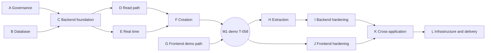

# KLESIA — Implementation Roadmap

**Document ID:** KLESIA-ROADMAP
**Created:** 2026-11-21
**Scope:** the whole KLESIA system — `klesia_api` (database, backend), `klesia_webapp` (SPA), the shared contract and the Azure delivery.
**Sources:** [`architecture-plan.md`](../architecture-plan.md) (v1.2), [`contracts/openapi.yaml`](../contracts/openapi.yaml) (v0.5.0), [`klesia_api/docs/specs/SPECIFICATIONS.md`](../klesia_api/docs/specs/SPECIFICATIONS.md) (v2.3), [`klesia_webapp/docs/specs/SPECIFICATIONS.md`](../klesia_webapp/docs/specs/SPECIFICATIONS.md) (v2.1), root and per-application `CLAUDE.md`, `.claude/skills/check-contract`, `.claude/skills/integration-test`, `.claude/agents/integration-reviewer`.
**Companion:** [`arbitrage.md`](arbitrage.md) — decisions and open questions.

This roadmap lists **unitary tasks in the recommended order of realisation** (the task number is the order). Each task has a detailed file `T-xxx.md` in this folder with its goal, context, plan of actions, acceptance criteria and verification commands. The roadmap does not replace the specifications: every task points to the requirement identifiers (`DEC-*`, `AT-*`, `AC-*`, …) that remain the authority.

---

## 1. Legend

### 1.1 Status

| Status | Meaning |
|---|---|
| `TODO` | Not started. The task may start **only** when it is *ready* (section 2). |
| `WIP` | Work in progress: an agent or a developer has started it. At most one owner at a time. |
| `DONE` | Finished: every acceptance criterion of its `T-xxx.md` is met and verified. A task made obsolete by an arbitrage is also set to `DONE`, with the mention *"Cancelled by ARB-xxx"* in its file. |
| `BLOCKED` | Waiting for an input that the development team cannot produce itself: an arbitrage still `OPEN`, an external dependency still `PENDING`, or a problem found during the work that needs a decision (recorded in the task file). |

### 1.2 Priority (indicative)

The priority only helps to organise the work; **it never overrides the dependencies**.

| Priority | Meaning |
|---|---|
| `P1` | Core path: needed for the reference scenario (architecture plan §2.2) to work end to end. |
| `P2` | Needed for quality, delivery or production, but not on the critical path of the feature. |
| `P3` | Documentation, housekeeping, final checks. |

### 1.3 Dependencies

| Prefix | Meaning | Satisfied when |
|---|---|---|
| `T-xxx` | Task that must be finished before. | Its status in the table of section 5 is `DONE`. |
| `ARB-xxx` | Arbitrage (decision or open question) that must be settled before. | The `Status` field of [`ARB-xxx.md`](arbitrage.md) is `SETTLED`. |
| `EXT-xxx` | External dependency, provided by someone outside the development team. | Its status in section 6 is `PROVIDED`. |

Only **gating** dependencies appear in the *Dependencies* column. Arbitrages that have a documented provisional default (`Blocking = NO` in [`arbitrage.md`](arbitrage.md)) are listed in the task file under *Related arbitrages (non-gating)*, never as dependencies.

### 1.4 Area

`root` = workspace root (contract, governance) · `db` = `klesia_api/database` · `api` = `klesia_api` · `web` = `klesia_webapp` · `infra` = infrastructure as code · `cross` = both applications and Azure.

---

## 2. Readiness rule (mandatory for every agent and developer)

> **A task can be implemented IF AND ONLY IF all of its dependencies are satisfied:** every `T-xxx` is `DONE`, every `ARB-xxx` is `SETTLED`, every `EXT-xxx` is `PROVIDED`.

Two workspace skills apply this protocol: **`/implement-task T-xxx`** (`.claude/skills/implement-task`) checks the gate, implements the task, verifies it and updates the statuses; **`/settle-arbitrage ARB-xxx`** (`.claude/skills/settle-arbitrage`) asks the questions of an arbitrage, records the decision and unblocks the waiting tasks. The task table of section 5 is authoritative for task status; the `Status` row of each `T-xxx.md` mirrors it (it reads *Tracked in roadmap.md* until a skill first updates it).

### 2.1 Protocol before starting a task

1. Open this file and find the task row in section 5.
2. For each dependency, check its state **at its source of truth**:
   - `T-xxx` → the *Status* column of section 5 of this file;
   - `ARB-xxx` → the `Status` field in the header table of `roadmap/ARB-xxx.md` (the [`arbitrage.md`](arbitrage.md) table is a synchronised copy);
   - `EXT-xxx` → the *Status* column of section 6 of this file.
3. If any dependency is not satisfied: **do not start**. Report which ones are missing. If an `ARB`/`EXT` is missing, the task status must be `BLOCKED`.
4. If all are satisfied: set the task to `WIP` in section 5 (one edit, nothing else), then read the task file entirely, then the specification sections it references.
5. Implement following the *Plan of actions*. Do not widen the scope: anything outside *Scope* becomes a new task or an arbitrage proposal.
6. Verify every *Acceptance criterion* with the *Verification commands*. Never claim a check passed unless it was run (root and application `CLAUDE.md`).
7. Fill the *Completion record* at the end of the task file (date, commits per repository, commands run and their result, items reported as *not run*).
8. Set the task to `DONE` in section 5. Then re-evaluate the tasks that depend on it (section 2.2).

### 2.2 Status transitions

| From | To | When |
|---|---|---|
| `TODO` | `BLOCKED` | A gating `ARB` is `OPEN` or a gating `EXT` is `PENDING`, or a blocking problem is found (described in the task file). |
| `BLOCKED` | `TODO` | Every `ARB`/`EXT` dependency is now satisfied and no recorded problem remains. |
| `TODO` | `WIP` | The task is *ready* (section 2) and someone starts it. |
| `WIP` | `BLOCKED` | A problem needing a decision is found; record it in the task file and, if it is a decision, propose a new `ARB`. |
| `WIP` | `DONE` | All acceptance criteria are verified and the completion record is filled. |

A task whose only unsatisfied dependencies are other **tasks** stays `TODO` (it is simply not ready yet). When an arbitrage is settled, `/settle-arbitrage` updates [`arbitrage.md`](arbitrage.md) from the `ARB-xxx.md` header and moves the concerned tasks from `BLOCKED` to `TODO` when nothing else blocks them.

### 2.3 Rules that apply to every task

- **Contract first** (root `CLAUDE.md`, architecture plan AP-01, GOV-01): no change on the HTTP boundary without the owning specification and `contracts/openapi.yaml` changing first, in the same change. A task that discovers such a need stops and proposes an arbitrage.
- **No speculative capability** (AP-14): no route, field, event, library or refresh trigger beyond the specifications.
- **Per-application rules**: follow `klesia_api/CLAUDE.md` or `klesia_webapp/CLAUDE.md` for the code of that application.
- **Nested repositories**: `klesia_api/` and `klesia_webapp/` are separate Git repositories; the root repository versions the contract, the governance and this roadmap. A cross-application task produces commits in several repositories and lists all of them in its completion record.
- **Environment-dependent checks** (real Entra tenant, Azure SQL, storage, SignalR, Document Intelligence) are reported as *not run* when their prerequisites are missing; they are never assumed to pass.
- **No secret** in any tracked file, log or report.

---

## 3. Baseline at roadmap creation (2026-11-21)

Already in place — not re-planned as tasks:

| Area | Existing |
|---|---|
| root | Contract v0.5.0 (five operations), architecture plan v1.2, `check-contract` skill (with `scripts/validate_contract.py`), `integration-test` skill, `integration-reviewer` agent. |
| db | SQL project `Klesia.Database.sqlproj` (`Microsoft.Build.Sql` 2.3.0, Azure SQL target), schemas `sec` and `ref`, tables `sec.Role`, `sec.User` (with `IX_User_RoleId`), `ref.Status`, `dbo.Demand` **without** `CreatedAt`, idempotent seeds `01_RefData.sql` and `02_User.sql`, `PostDeployment.sql`, publish profile `Azure.publish.xml` (data-loss blocking on, no drop). |
| api | Solution `Klesia.sln` with `Domain`, `Application`, `Infrastructure`, `WebApi`, `UnitTests`, `IntegrationTests` projects (csproj only, **no C# source**), `Directory.Build.props` (`net10.0`, warnings as errors), central package versions, `global.json`, docs `local-development.md` and `deployment-app-service.md`, `.claude` agents/skills/hooks. `appsettings.json` diverges from spec §6.1 (handled by T-007). No `.github/workflows`. |
| web | `package.json` with three scripts only, `public/assets` (`user_logo.png`, `pdf_logo.png`), `maquettes/` (`main.png`, `modal.png`, `states.png`), `infra/azure-signalr/` (unvalidated Bicep draft), `.claude` agents/skills. **No `src/`, no Vite/TypeScript configuration, no tests.** No `.github/workflows`. `docs/TASKS.md` is referenced by the architecture plan but does not exist (ARB-001). |

---

## 4. Phases

| Phase | Tasks | Content |
|---|---|---|
| A — Governance | T-001, T-002 | Baseline audit, work-tracking alignment |
| B — Database | T-003 to T-006 | Missing column and extraction tables, DACPAC verification |
| C — Backend foundation | T-007 to T-023 | Configuration, domain, host, test harness, CI, middleware, authentication, allowlist, health |
| D — Backend read path | T-024 to T-028 | Demand list and document streaming |
| E — Backend real time | T-029 to T-031 | Notifier port and adapter, negotiate |
| F — Backend creation | T-032 to T-036 | Validation, persistence, queue, use case, endpoint (N-1; no extraction consumer yet) |
| G — Frontend (demo path) | T-037 to T-057 | Scaffold, configuration, model, simulator, auth, services, components, orchestration |
| **M1 — Demo milestone** | **T-058** | Local demo on dev Azure resources: list, open PDF, create with N-1 (section 8) |
| H — Backend extraction | T-059 to T-065 | Answer model, validation, persistence, use case, workers, Document Intelligence |
| I — Backend hardening | T-066 to T-068 | Contract validation, security review, documentation |
| J — Frontend hardening | T-069 to T-074 | Security headers, security tests, simulator test, UI review, documentation, acceptance gate |
| K — Cross-application | T-075 to T-078 | Contract check, boundary review, environment-dependent tests |
| L — Infrastructure and delivery | T-079 to T-090 | IaC, pipelines, dev deployment, production readiness |
| Follow-ups | T-091 | Tasks added after the roadmap creation |

Phases C–F (backend) and G (frontend) can progress in parallel: the frontend is developed against the dev simulator (T-045), which implements the same contract. They meet at the milestone T-058.

---

## 5. Task table

| Task number | Status | Task | Compact description | Dependencies | Priority | Area |
|---|---|---|---|---|---|---|
| [T-001](T-001.md) | DONE | Baseline contract and repository audit | Run `check-contract` on the current state and record the baseline findings | — | P1 | root |
| [T-002](T-002.md) | DONE | Align work-tracking references | Point the architecture plan and webapp `CLAUDE.md` to the roadmap instead of the missing `docs/TASKS.md` | `ARB-001` | P3 | root |
| [T-003](T-003.md) | DONE | Add `CreatedAt` to `dbo.Demand` | Add the UTC creation column with its named default (DEC-23) | — | P1 | db |
| [T-004](T-004.md) | DONE | Create `dbo.DemandInformation` | Declare the extraction information table with its checks (§3.3, §3.4) | — | P1 | db |
| [T-005](T-005.md) | DONE | Create `dbo.DemandFormula` | Declare the formula table and its FK index | `T-004` | P1 | db |
| [T-006](T-006.md) | DONE | Verify DACPAC build, publish profile and seeds | Build the SQL project, review the publish profile, seeds and backward compatibility | `T-003`, `T-005` | P1 | db |
| [T-007](T-007.md) | DONE | Align API configuration files | Make `appsettings*.json` match spec §6.1 and remove speculative sections | `T-001` | P1 | api |
| [T-008](T-008.md) | DONE | Domain model | Entities and value objects: user, demand, GK number, status, extraction | `T-010` | P1 | api |
| [T-009](T-009.md) | DONE | Strongly typed options and startup validation | Bind and validate every configuration section; refuse to start on placeholders | `T-007`, `T-092` | P1 | api |
| [T-010](T-010.md) | DONE | WebApi composition root | `Program.cs`, layer registration methods, controllers, OpenAPI in Development | `T-009` | P1 | api |
| [T-011](T-011.md) | BLOCKED | API CI workflow | GitHub Actions: restore, build, test, SQL project build on every push/PR | `T-006`, `T-010` | P2 | api |
| [T-012](T-012.md) | DONE | Backend integration-test harness | `WebApplicationFactory`, signed test tokens, fakes, log capture | `T-010` | P1 | api |
| [T-013](T-013.md) | DONE | SQL constraint tests (opt-in) | Tests of §3.6 / AT-15, AT-16, AT-49, run only with `KLESIA_TEST_SQL_CONNECTION` | `T-006`, `T-012` | P2 | api |
| [T-014](T-014.md) | DONE | Correlation id and request logging | `X-Correlation-Id` middleware and structured, redacted request logs | `T-012` | P1 | api |
| [T-015](T-015.md) | TODO | ProblemDetails and exception handling | `application/problem+json` for every non-2xx, sanitised, `traceId` = correlation id | `T-014` | P1 | api |
| [T-016](T-016.md) | TODO | CORS policy | Exact configured origins, methods, headers, max age, no credentials | `T-012` | P1 | api |
| [T-017](T-017.md) | TODO | HTTPS behind the App Service front end | Forwarded headers trusted correctly, no redirect loop (HOST-02, AT-36) | `T-012` | P2 | api |
| [T-018](T-018.md) | TODO | JWT bearer authentication | v2 access-token validation, `tid`, `nonce`, `oid` checks, `401` problem body | `T-015` | P1 | api |
| [T-019](T-019.md) | TODO | Delegated-scope policy | `DelegatedUser` policy as default and fallback, `403` problem body | `T-018` | P1 | api |
| [T-020](T-020.md) | TODO | SQL connection factory and user repository | Passwordless `SqlConnection` factory and `IUserRepository` (Dapper) | `T-008`, `T-009` | P1 | api |
| [T-021](T-021.md) | TODO | Database allowlist gate | Resolve the active user from `oid`; identical `403` for unknown and inactive | `T-019`, `T-020` | P1 | api |
| [T-022](T-022.md) | TODO | `GET /health` | Anonymous probe with SQL check, `200`/`503` (AT-22, AT-34) | `T-015`, `T-020` | P1 | api |
| [T-023](T-023.md) | BLOCKED | Contract schema-validation helper | Test helper validating responses against `contracts/openapi.yaml` | `T-012`, `ARB-003` | P2 | api |
| [T-024](T-024.md) | TODO | Demand repository: list by owner | Dapper query of the owner's demands with status code, `Id DESC` | `T-020` | P1 | api |
| [T-025](T-025.md) | TODO | `GET /api/v1/demands` | List use case, snake_case contract records, controller (AT-01 to AT-12, AT-55) | `T-016`, `T-021`, `T-024` | P1 | api |
| [T-026](T-026.md) | TODO | `IBaeDocumentStore` and Blob adapter | Create-only upload, streamed read, best-effort delete, managed identity | `T-008`, `T-009` | P1 | api |
| [T-027](T-027.md) | TODO | Demand repository: owned document lookup | One query by demand id **and** owner returning the internal blob URL | `T-024` | P1 | api |
| [T-028](T-028.md) | TODO | `GET /api/v1/demands/{demand_id}/bae` | Stream the owner's PDF with the specified headers, `404`/`500`/`503` | `T-025`, `T-026`, `T-027` | P1 | api |
| [T-029](T-029.md) | TODO | `INotifier` port | Application port "the demands of this `oid` changed" and its test double | `T-008` | P1 | api |
| [T-030](T-030.md) | BLOCKED | Azure SignalR notifier adapter | User-targeted `demandUpdated`, managed identity, short timeout, best effort | `T-009`, `T-029`, `ARB-004` | P1 | api |
| [T-031](T-031.md) | BLOCKED | `POST /api/v1/notifications/negotiate` | Allowlisted negotiation returning `{url, accessToken}` with `userId` = `oid` | `T-016`, `T-021`, `T-030`, `ARB-004` | P1 | api |
| [T-032](T-032.md) | TODO | Creation request validators | GK number, multipart parts, PDF magic bytes and size rules | `T-008`, `T-009` | P1 | api |
| [T-033](T-033.md) | TODO | Demand repository: create pending demand | Dapper insert with status `pending` resolved by code, returns the id | `T-003`, `T-024` | P1 | api |
| [T-034](T-034.md) | TODO | `IExtractionQueue` and bounded channel | Non-blocking in-process queue of demand ids (EXT-01) | `T-009` | P1 | api |
| [T-035](T-035.md) | TODO | Demand creation use case | Upload → insert → commit → N-1 → enqueue, with cleanup and `503` | `T-021`, `T-026`, `T-030`, `T-032`, `T-033`, `T-034` | P1 | api |
| [T-036](T-036.md) | TODO | `POST /api/v1/demands` | Multipart endpoint, request limits, status mapping (AT-23 to AT-30, AT-39, AT-48, AT-50, AT-56) | `T-016`, `T-025`, `T-035` | P1 | api |
| [T-037](T-037.md) | TODO | Scaffold the webapp | Vue 3 + Vite + strict TS, ESLint, Prettier, Vitest, npm scripts, `.nvmrc` | — | P1 | web |
| [T-038](T-038.md) | TODO | Webapp CI workflow | GitHub Actions: type-check, lint, format check, tests, audit, build | `T-037` | P2 | web |
| [T-039](T-039.md) | TODO | Design tokens and global styles | CSS variables of UI-04, focus/hover/disabled styles, base layout | `T-037` | P2 | web |
| [T-040](T-040.md) | TODO | Build-time environment configuration | `environment.ts` validation of the six `VITE_*` values, `.env.example` | `T-037` | P1 | web |
| [T-041](T-041.md) | TODO | Runtime configuration | `public/config/app-config.json` and `runtimeConfig.ts` (AC-20) | `T-037` | P1 | web |
| [T-042](T-042.md) | TODO | Domain model `demand.ts` | Hand-written contract mirror and `parseUserDemands` (MODEL-01 to MODEL-03) | `T-037` | P1 | web |
| [T-043](T-043.md) | TODO | GK number validation | `utils/gk.ts` normalisation and pattern (NEW-03, AC-10, AC-11) | `T-037` | P1 | web |
| [T-044](T-044.md) | TODO | PDF file validation | `utils/pdf.ts` extension, MIME and size rules (NEW-04, AC-13) | `T-041` | P1 | web |
| [T-045](T-045.md) | TODO | Dev simulator | `tools/dev-simulator`: REST, negotiate, SignalR JSON protocol, controls (SIM-01 to SIM-05) | `T-037` | P1 | web |
| [T-046](T-046.md) | TODO | MSAL redirect bridge and SWA routing | `redirect.html` entry, `staticwebapp.config.json` fallback and `no-store` (AC-33) | `T-037` | P1 | web |
| [T-047](T-047.md) | TODO | `authService.ts` | MSAL v5 singleton, redirect handling, access token, controlled recovery | `T-040`, `T-046` | P1 | web |
| [T-048](T-048.md) | TODO | `demandService`: HTTP core and list | Authenticated request helper, error mapping, `listDemands` (DEM-01, AC-24, AC-25) | `T-042`, `T-047` | P1 | web |
| [T-049](T-049.md) | TODO | `demandService`: create | `createDemand` multipart, any 2xx, never retried (NEW-06 to NEW-08) | `T-048` | P1 | web |
| [T-050](T-050.md) | TODO | `demandService`: document | `fetchDemandDocument` PDF fetch, content-type check, one 401 recovery | `T-048` | P1 | web |
| [T-051](T-051.md) | TODO | `realtimeService.ts` | Single `HubConnection`, token factory, retry policy, status events (RT-01 to RT-08) | `T-047` | P1 | web |
| [T-052](T-052.md) | TODO | `useDemandList` coalesced reload | One shared reload, never two GETs in flight, preserved list on error (RT-04) | `T-048` | P1 | web |
| [T-053](T-053.md) | TODO | App shell, auth gate and header | `App.vue`/`main.ts` startup, configuration errors, `AppHeader.vue` (AUTH-04, AUTH-05) | `T-039`, `T-040`, `T-047` | P1 | web |
| [T-054](T-054.md) | TODO | `DemandList.vue` | Rows, French labels and colours, loading/empty/error/connection states (UI-07) | `T-039`, `T-052`, `T-053` | P1 | web |
| [T-055](T-055.md) | TODO | BAE document opening | Link-styled button, blank tab, object URL, failure messages (DEM-03) | `T-050`, `T-054` | P1 | web |
| [T-056](T-056.md) | TODO | `NewDemandModal.vue` | Accessible dialog, validation, submission states and errors (NEW-01 to NEW-09) | `T-039`, `T-041`, `T-043`, `T-044`, `T-049` | P1 | web |
| [T-057](T-057.md) | TODO | App orchestration | Real-time wiring, initial GET timing, no GET on POST success (AC-52 to AC-54) | `T-051`, `T-052`, `T-054`, `T-056` | P1 | web |
| [T-058](T-058.md) | BLOCKED | **Milestone M1 — local demo** | Local API + SPA on dev Azure resources: list demands, open a PDF, create a demand (blob + `pending` row + N-1), no extraction | `T-006`, `T-022`, `T-028`, `T-031`, `T-036`, `T-055`, `T-057`, `EXT-001`, `EXT-003`, `EXT-005`, `EXT-006` | P1 | cross |
| [T-059](T-059.md) | TODO | Extraction answer model, port and parser | EXT-04 record, `IDocumentExtractor`, strict JSON parsing (AT-42) | `T-008` | P1 | api |
| [T-060](T-060.md) | TODO | Extraction answer validator | EXT-05 rules incl. Luhn SIREN/SIRET and La Poste exception (AT-43) | `T-059` | P1 | api |
| [T-061](T-061.md) | TODO | Extraction repository | Read for extraction, save + `ok` in one transaction, set `fail`, list stale | `T-003`, `T-005`, `T-020` | P1 | api |
| [T-062](T-062.md) | TODO | Extraction use case (steps 2 and 3) | Guard, read blob, extract, validate, store or fail, N-2 | `T-026`, `T-029`, `T-060`, `T-061` | P1 | api |
| [T-063](T-063.md) | TODO | Extraction worker | Hosted service with bounded concurrency and clean shutdown (EXT-01, EXT-08) | `T-034`, `T-062` | P1 | api |
| [T-064](T-064.md) | TODO | Recovery sweep worker | Re-enqueue stale `pending` demands at startup and periodically (EXT-09) | `T-063` | P2 | api |
| [T-065](T-065.md) | BLOCKED | Document Intelligence adapter | Real `IDocumentExtractor` with managed identity and timeout; wires extraction and its configuration in `Program.cs` | `T-059`, `T-063`, `ARB-005`, `EXT-007` | P1 | api |
| [T-066](T-066.md) | TODO | Contract validation in backend tests | Validate every integration-test response against the contract | `T-022`, `T-023`, `T-028`, `T-031`, `T-036` | P2 | api |
| [T-067](T-067.md) | TODO | Backend security and log-redaction review | Security audit, log-capture tests, secret scan | `T-028`, `T-031`, `T-036`, `T-064` | P2 | api |
| [T-068](T-068.md) | TODO | Backend documentation refresh | README, local development and deployment guides in sync with the code | `T-036`, `T-064` | P3 | api |
| [T-069](T-069.md) | TODO | SWA security headers and CSP | DEP-05 headers in `staticwebapp.config.json` and their tests (AC-48) | `T-046` | P2 | web |
| [T-070](T-070.md) | TODO | Frontend security test suite | AC-43 to AC-47, AC-49 static and runtime checks | `T-055`, `T-057`, `T-069` | P2 | web |
| [T-071](T-071.md) | TODO | Simulator integration test | AC-51 against the dev simulator | `T-045`, `T-057` | P2 | web |
| [T-072](T-072.md) | TODO | UI review against the mockups | Visual check of `main.png`, `modal.png`, `states.png` (UI-03, UI-06, UI-07) | `T-055`, `T-057` | P2 | web |
| [T-073](T-073.md) | TODO | Webapp documentation | README: setup, commands, Azure prerequisites, backend dependencies (DEP-03, DEP-04) | `T-057`, `T-069` | P3 | web |
| [T-074](T-074.md) | TODO | Frontend acceptance gate | Full build gate AC-21, AC-42 and `/review-ac` on AC-01 to AC-56 | `T-070`, `T-071`, `T-072`, `T-073` | P1 | web |
| [T-075](T-075.md) | TODO | Full contract check | `check-contract` on all steps with `--model` and `--actual` | `T-066`, `T-074` | P1 | root |
| [T-076](T-076.md) | TODO | Boundary review | `integration-reviewer` on the complete cross-application change set | `T-075` | P1 | root |
| [T-077](T-077.md) | BLOCKED | Run SQL constraint tests | Execute T-013 tests on a disposable published Azure SQL database | `T-013`, `EXT-004` | P2 | api |
| [T-078](T-078.md) | BLOCKED | Live wire integration test | Level 3 of `integration-test`: real Entra, dev Azure resources, contract proxy | `T-076`, `EXT-001`, `EXT-002`, `EXT-003`, `EXT-005`, `EXT-006` | P2 | cross |
| [T-079](T-079.md) | BLOCKED | Azure SignalR IaC alignment | Validate and align `infra/azure-signalr` with ARB-004 and the IaC ownership | `ARB-004`, `ARB-009`, `ARB-010` | P2 | infra |
| [T-080](T-080.md) | BLOCKED | IaC: managed identity and role assignments | User-assigned identity and its roles on storage, DI, SignalR | `ARB-004`, `ARB-009`, `ARB-010` | P2 | infra |
| [T-081](T-081.md) | BLOCKED | IaC: storage account | Private container, shared key disabled, settings of ARB-014 | `T-080`, `ARB-009`, `ARB-010`, `ARB-012`, `ARB-014` | P2 | infra |
| [T-082](T-082.md) | BLOCKED | IaC: Azure SQL | Logical server, database, Entra admin, network per ARB-012/013 | `T-080`, `ARB-009`, `ARB-010`, `ARB-012`, `ARB-013` | P2 | infra |
| [T-083](T-083.md) | BLOCKED | IaC: App Service | Plan and web app: Always On, HTTPS Only, TLS 1.2, Health check, identity, settings | `T-080`, `ARB-009`, `ARB-010`, `ARB-011`, `ARB-012` | P2 | infra |
| [T-084](T-084.md) | BLOCKED | IaC: Static Web App | Static Web App resource per environment | `ARB-009`, `ARB-010`, `ARB-018` | P2 | infra |
| [T-085](T-085.md) | BLOCKED | Per-environment allowlist seed | Make `02_User.sql` environment-aware according to ARB-019 | `T-006`, `ARB-019` | P2 | db |
| [T-086](T-086.md) | BLOCKED | API delivery pipeline | Build, test, SqlPackage publish, deploy, health smoke test, rollback (HOST-11) | `T-011`, `T-082`, `T-083`, `T-085`, `ARB-011`, `ARB-017`, `EXT-008` | P2 | api |
| [T-087](T-087.md) | BLOCKED | Webapp delivery pipeline | Per-environment build and deployment of `dist/` to Static Web Apps | `T-038`, `T-084`, `ARB-017`, `ARB-018` | P2 | web |
| [T-088](T-088.md) | BLOCKED | Dev environment deployment and verification | Deploy both applications to dev and run AT-33, AT-35, AT-57 prerequisites | `T-065`, `T-076`, `T-079`, `T-081`, `T-086`, `T-087`, `EXT-001`, `EXT-007` | P2 | cross |
| [T-089](T-089.md) | TODO | PDF viewer check under production headers | Manual AC-57 in Chrome, Edge and Firefox on the deployed dev SWA | `T-088` | P3 | web |
| [T-090](T-090.md) | TODO | Production readiness and go-live | Every arbitrage settled, open items answered, production checklist executed | `T-077`, `T-078`, `T-088`, `T-089` | P3 | cross |
| [T-091](T-091.md) | TODO | Fix wording drift in webapp documents | AUTH-03 and webapp `CLAUDE.md` say "both" protected operations (three exist); Appendix A section number | — | P3 | web |
| [T-092](T-092.md) | DONE | Resolve vulnerable `System.Security.Cryptography.Pkcs` | Transitive 9.0.11 has a high (NU1903) and a moderate (NU1902) advisory on every API build | — | P2 | api |

---

## 6. External dependencies

| Code | Subject | Provided by | Needed by | Status |
|---|---|---|---|---|
| `EXT-001` | Entra ID app registrations: tenant id, API app (v2 access tokens, scope `access_as_user`), SPA app (redirect URIs incl. `/redirect.html`), consent, optional claims `given_name`/`family_name` (OPEN-03, INT-01) | Client tenant administrator / DSI | T-058, T-078, T-088 | PENDING |
| `EXT-002` | Entra test accounts: one allowlisted active user, one inactive user, one non-allowlisted user, with their `oid` | Client tenant administrator | T-078 | PENDING |
| `EXT-003` | Dev Azure SQL database with the developer's Entra database user and firewall/private access (DEC-06, OPEN-07) | DSI / Azure administrator | T-058, T-078 | PENDING |
| `EXT-004` | Disposable Azure SQL database for constraint tests (`KLESIA_TEST_SQL_CONNECTION`) | DSI / Azure administrator | T-077 | PENDING |
| `EXT-005` | Dev storage account with a private container and *Storage Blob Data Contributor* for the developer | DSI / Azure administrator | T-058, T-078 | PENDING |
| `EXT-006` | Dev Azure SignalR Service (Serverless) with CORS for `http://localhost:5173` and a role for the developer | DSI / Azure administrator | T-058, T-078 | PENDING |
| `EXT-007` | Document Intelligence: trained custom BAE model, endpoint, model id, *Cognitive Services User* role, anonymised sample PDFs with their expected answers (OPEN-09) | Document Intelligence owners | T-065, T-088 | PENDING |
| `EXT-008` | GitHub → Azure OpenID Connect federated credential(s), deployment principal(s) and SQL deployment principal (OPEN-08i) | DSI / Azure administrator | T-086 | PENDING |

An `EXT` moves from `PENDING` to `PROVIDED` when the values or access are actually available to the team (never committed to the repository if sensitive; record *where* they are, not their value).

---

## 7. Arbitrages

The decisions and open questions are listed in [`arbitrage.md`](arbitrage.md), each with its file `ARB-xxx.md`. The `Status` field in the header of each `ARB-xxx.md` is authoritative.

---

## 8. Milestones

A milestone is an ordinary task whose dependencies are exactly what an intermediate, demonstrable stage needs. It follows the readiness rule of section 2 like any task.

| Milestone | Task | Demonstrable stage | Gating items still open at creation |
|---|---|---|---|
| **M1 — Demands without extraction** | [T-058](T-058.md) | Running locally (`dotnet run` + `npm run dev`) against real Entra ID and the dev Azure SQL, Blob Storage and SignalR resources: (1) the user sees the list of their demands and can open a demand's PDF; (2) the user creates a demand: the PDF is copied to Blob Storage, the row is inserted with status `pending`, the backend sends N-1 and the list reloads through SignalR. No extraction and no Document Intelligence call: new demands stay "En cours". | `ARB-004` (through T-030, T-031), `EXT-001`, `EXT-003`, `EXT-005`, `EXT-006` |

What M1 deliberately does not include: the extraction (T-059 to T-065, so no N-2 and no `ok`/`fail` transition), the frontend and backend hardening (T-066 to T-074), any Azure deployment (T-079 to T-090). The specifications and the contract are unchanged: they describe the whole application without phasing; M1 exercises a subset of that behaviour.

Ready at creation of the roadmap (informative): T-001, T-003, T-004, T-008, T-037 (section 2 is the rule).

---

## 9. Change log

| Date | Change |
|---|---|
| 2026-11-21 | Roadmap created: 89 tasks, 24 arbitrages, 8 external dependencies. |
| 2026-11-22 | Skills `/implement-task` and `/settle-arbitrage` added; `T-xxx.md` Status rows mirror section 5. |
| 2026-11-22 | T-001 DONE (report `reports/T-001-baseline.md`); T-091 and ARB-025 created from its findings. |
| 2026-11-22 | ARB-001 settled; T-002 unblocked (`BLOCKED` → `TODO`). |
| 2026-11-22 | Reorganised for milestone M1 (section 8): frontend demo path renumbered T-047…T-067 → T-037…T-057; new milestone task T-058; extraction and backend hardening T-037…T-046 → T-059…T-068; T-068…T-090 → T-069…T-091. All references in `roadmap/` updated. Document Intelligence and extraction options are validated at startup only once the extraction is wired (T-009, T-065). |
| 2026-11-22 | T-002 and T-003 DONE; T-092 created by T-003 (vulnerable transitive package found by the solution build). |
| 2026-11-22 | T-004 DONE: added `dbo.DemandInformation`; SQL project builds and DACPAC contains the table. Full solution build/test remain blocked by missing WebApi `Main` (T-010). |
| 2026-11-22 | T-005 DONE: added `dbo.DemandFormula`; SQL project builds and DACPAC contains the table, FK and index. Full solution build/test remain blocked by missing WebApi `Main` (T-010). |
| 2026-11-22 | T-006 DONE: SQL project, six-table object inventory, seeds and safe publish-profile checks pass; live publish was not run (no target database configured). |
| 2026-11-22 | T-007 DONE: aligned tracked API settings and local-development example to §6.1; JSON and ignore checks pass. Full solution build/test hit the existing missing WebApi entry point (T-010). |
| 2026-11-22 | T-008 Domain model implemented and its isolated build/tests pass; task is BLOCKED on T-010 because full solution verification fails with the missing WebApi entry point. |
| 2026-11-22 | T-009 validators/options implemented; task BLOCKED on T-092 because NU1902/NU1903 prevent its warning-free build criterion. Full host startup verification remains assigned to T-010. |
| 2026-11-22 | T-092 DONE: pinned Pkcs 9.0.21 in the two SqlClient dependency roots; audit is clean, Infrastructure build warning-free, UnitTests pass. T-009 unblocked. |
| 2026-11-22 | T-009 DONE: option validation and 59 UnitTests pass; Infrastructure builds with zero warnings. Full-solution CS5001 remains assigned to T-010. |
| 2026-11-22 | T-010 DONE: added the WebApi composition root and layer registration entry points; solution builds, placeholder startup fails fast, valid startup works, OpenAPI is Development-only, and project references remain inward. |
| 2026-11-22 | T-008 DONE: Domain entities and value objects pass 20 focused tests; the isolated Domain build and full solution build/test pass with no Domain-layer references. |
| 2026-11-22 | T-011 partial: API CI workflow added; local Release restore/build/test and DACPAC build pass. GitHub-hosted run URL remains unverified, so the task is BLOCKED pending an authorized push. |
| 2026-11-22 | T-012 DONE: integration-test host, RSA test tokens, static JWT metadata hook, service replacement helpers and log sink pass 11 focused harness tests; full solution passes 70 tests. |
| 2026-11-22 | T-013 DONE: opt-in SQL constraint suite added; without KLESIA_TEST_SQL_CONNECTION, 6 facts skip explicitly and the full solution passes 70 tests. Live disposable-SQL execution remains T-077. |
| 2026-11-22 | T-014 DONE: X-Correlation-Id middleware, JSON console scopes and redacted request logging pass integration tests; full solution passes 76 tests with 6 SQL skips. |
